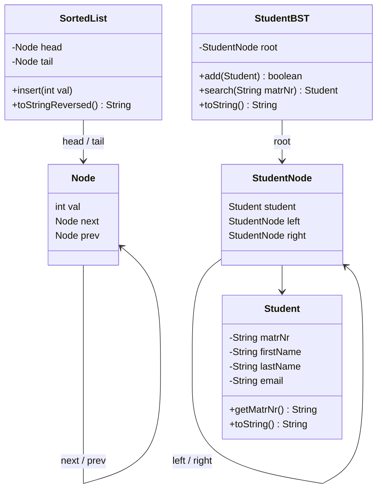

# Dynamische Datenstrukturen: doppelt verkettete Liste und binärer Suchbaum

Zwei klassische dynamische Datenstrukturen in Java, von Grund auf mit eigenen Knotenklassen umgesetzt:

1. eine **sortierte, doppelt verkettete Liste** für ganze Zahlen, die sich auch von hinten nach vorne durchlaufen lässt
2. ein **binärer Suchbaum**, der Studierende nach ihrer Matrikelnummer verwaltet

Entstanden als **Übung 02** in der Lehrveranstaltung *Objektorientiertes Softwaredesign (OOS)* an der FH Hagenberg, WS 2026/27. Thema der Übung: **Dynamische Datenstrukturen (Listen und Bäume)**.

---

## Teil 1: Sortierte doppelt verkettete Liste (`SortedList`)

### Idee

In einer einfach verketteten Liste kennt jeder Knoten nur seinen Nachfolger. Bei einer doppelt verketteten Liste kennt jeder Knoten zusätzlich seinen Vorgänger. Zusammen mit einem Zeiger auf das letzte Element (`tail`) lässt sich die Liste so auch rückwärts durchlaufen.

```
head                              tail
 ↓                                 ↓
[ 3 ] ⇄ [ 5 ] ⇄ [ 8 ]
```

### Funktionen

- **`insert(int val)`** fügt einen Wert an der richtigen Stelle ein, sodass die Liste immer aufsteigend sortiert bleibt. Dabei werden sowohl die `next`- als auch die `prev`-Zeiger der Nachbarknoten angepasst. Abgedeckt sind alle Fälle: leere Liste, Einfügen am Anfang, in der Mitte und am Ende. Duplikate sind erlaubt.
- **`toStringReversed()`** gibt die Liste von hinten nach vorne als String zurück. Die Methode startet bei `tail` und folgt rekursiv den `prev`-Zeigern.

### Beispielausgabe

`Main` testet die Liste mit mehreren Fällen, auch mit Grenzfällen:

| Fall                              | Ausgabe von `toStringReversed()` |
|-----------------------------------|----------------------------------|
| Werte 3, 5, 8                     | `8 5 3`                          |
| leere Liste                       | *(leerer String)*                |
| 3, 2, 1, 3, 4, 7, 4, 7 (Duplikate) | `7 7 4 4 3 3 2 1`                |
| zusätzlich 0 (neuer kleinster Wert) | `7 7 4 4 3 3 2 1 0`            |
| zusätzlich −1 (negativer Wert)    | `7 7 4 4 3 3 2 1 0 -1`           |
| zusätzlich 12 (neuer größter Wert) | `12 7 7 4 4 3 3 2 1 0 -1`       |

Die Ausgaben sind auch in `toStringReversedAusgabenprotokoll.pdf` dokumentiert.

---

## Teil 2: Binärer Suchbaum für Studierende (`StudentBST`)

### Idee

In einem binären Suchbaum hat jeder Knoten höchstens zwei Kinder. Alles im linken Teilbaum ist kleiner als der Knoten, alles im rechten Teilbaum ist größer. Dadurch muss man beim Suchen und Einfügen bei jedem Schritt nur einem Ast folgen, statt alle Einträge durchzugehen.

Als Schlüssel dient die **Matrikelnummer**. Sie wird lexikografisch mit `String.compareTo()` verglichen.

```
              1000 (Max)
             /          \
      0500 (Anna)    2000 (John)
```

### Funktionen

- **`add(Student student)`** fügt einen Studierenden an der passenden Stelle ein. Liefert `false`, wenn die Matrikelnummer schon vorhanden ist oder `null` übergeben wird.
- **`search(String matrNr)`** sucht rekursiv nach einer Matrikelnummer. Liefert den gefundenen `Student` oder `null`.
- **`toString()`** gibt alle Studierenden aufsteigend nach Matrikelnummer aus, einen pro Zeile. Dafür wird der Baum in Inorder-Reihenfolge durchlaufen: links, Knoten, rechts.

### Beispiel

```java
StudentBST tree = new StudentBST();
tree.add(new Student("Max",  "Mustermann", "max@test.com",  "1000"));
tree.add(new Student("Anna", "Schmidt",    "anna@test.com", "0500"));
tree.add(new Student("John", "Doe",        "john@test.com", "2000"));

tree.search("0500");   // liefert Anna
tree.search("0200");   // liefert null
System.out.print(tree);
```

Ausgabe:

```
Vorname: Anna Nachname: Schmidt E-Mail: anna@test.com Matrikelnummer: 0500
Vorname: Max Nachname: Mustermann E-Mail: max@test.com Matrikelnummer: 1000
Vorname: John Nachname: Doe E-Mail: john@test.com Matrikelnummer: 2000
```

### Tests

`StudentBSTTest` prüft alle drei Methoden mit JUnit 5:

| Test             | geprüft wird |
|------------------|--------------|
| `testAdd`        | Einfügen als Wurzel, links und rechts; Ablehnen von Duplikaten und `null` |
| `testSearch`     | Suche im leeren Baum, Finden vorhandener Studierender, Suche nach einer nicht vorhandenen Matrikelnummer |
| `testToString`   | sortierte Ausgabe in Inorder-Reihenfolge |

---

## Klassenübersicht



## Projektstruktur

```
Uebung_Dynamische_Datenstrukturen/
├── src/
│   ├── SortedList.java       SortedList und Node
│   ├── StudentBST.java       StudentBST, StudentNode und Student
│   ├── StudentBSTTest.java   JUnit-Tests für den Suchbaum
│   └── Main.java             Testprogramm für die Liste
└── toStringReversedAusgabenprotokoll.pdf
```

## Voraussetzungen

- **JDK 25** oder neuer. `Main` nutzt die vereinfachte `main`-Methode ohne `String[] args` und die Klasse `IO`. Beides ist erst ab Java 25 final. Im IntelliJ-Projekt ist JDK 26 eingestellt.
- **JUnit 5** für die Tests. Die Bibliothek ist in der Projektdatei eingetragen, aber nicht im Repository enthalten. Meldet IntelliJ nach dem Klonen, dass JUnit fehlt, auf **Add JUnit 5 to classpath** bzw. **Fix** klicken.
- IntelliJ IDEA (empfohlen, Projektdateien sind enthalten)

## Ausführen

- **Liste testen:** `Main` öffnen und über den grünen Pfeil neben `main` starten.
- **Suchbaum testen:** `StudentBSTTest` öffnen und über den grünen Pfeil neben der Klasse starten.

## Dokumentation

Die Klassen des Suchbaums (`Student`, `StudentNode`, `StudentBST`) sind mit Javadoc dokumentiert.

## Eigene Arbeit und Vorgaben

Von der Lehrveranstaltung bereitgestellt wurden:
- die Klasse `Node` und eine **einfach** verkettete Version von `SortedList` mit `insert()`
- die Klasse `StudentNode` und ein Gerüst von `StudentBST`
- ein Gerüst von `StudentBSTTest` mit dem Test `testAdd`

Selbst umgesetzt wurden:
- die Umstellung von `insert()` auf eine doppelt verkettete Liste
- `toStringReversed()`
- die Klasse `Student`
- `add()`, `search()` und die Inorder-Traversierung für `toString()` in `StudentBST`
- die Tests `testSearch` und `testToString`
- das Testprogramm `Main` mit den Grenzfällen und das Ausgabenprotokoll
- die Javadoc-Dokumentation

## Autor

Eric Keplinger, FH Hagenberg
